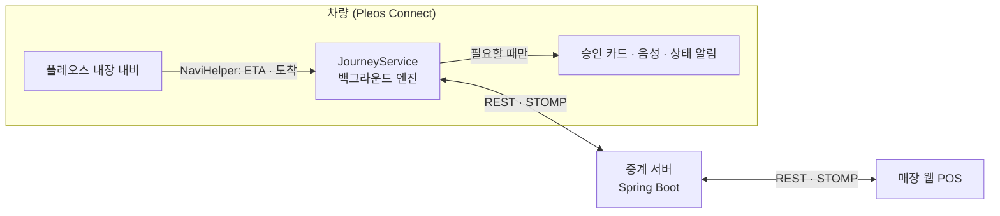

# 스마트 저니 (Smart Journey)

> 플레오스 내비 뒤에서 조용히 돌면서, 차가 확인한 탑승 인원·도착·하차 정보로 맛집 원격 웨이팅을 대신 걸어 주는 Pleos Connect 차량용 앱

운전자는 평소처럼 내비를 보며 갑니다. 앱은 뒤에서 남은 도착 시간과 매장 대기시간을 비교하다가, 도착 직후 호출이 오는 시점이 되면 **승인 카드 한 장 또는 음성**으로 "지금 웨이팅 걸까요?"라고 묻습니다. 도착하면 도착 이벤트, 정차, 도어, 좌석 변화를 종합해 "N명 중 M명 하차"를 매장 POS에 알려 줍니다.

## 핵심 아이디어: 차가 증명하는 웨이팅

| 순간 | 폰 앱 | 스마트 저니 | 사용하는 차량 신호 |
| --- | --- | --- | --- |
| 접수 | 인원을 직접 입력 | 좌석 점유로 인원 제안 | 좌석 점유, 안전벨트 |
| 이동 중 | 언제 걸지 직접 판단 | 골든타임에 승인 카드·음성으로 알림 | 내비 남은 시간 |
| 도착 | 위치 인증·코드 입력 | 하차 인원을 매장에 자동 전송 | 내비 도착 이벤트, 주행 상태, 도어, 좌석 |
| 재출발 | 인원 변동 반영 불가 | 다음 매장 인원 변경 제안 | 좌석 점유 |

## 앱이 동작하는 방식

스마트 저니는 지도를 새로 만들지 않습니다. 길 안내와 지도는 **플레오스 내장 내비**가 그대로 맡고, 앱은 NaviHelper SDK로 목적지·경유지를 넣고 남은 시간과 도착 이벤트를 받아 옵니다.

| 층 | 역할 | 구성 |
| --- | --- | --- |
| 1. 백그라운드 엔진 | 내비 ETA·도착 이벤트 구독, 좌석·벨트·도어 감시, 골든타임 계산, 하차 확인, 서버 연결 유지 | `JourneyService` (포그라운드 서비스) |
| 2. 필요할 때만 뜨는 접점 | 골든타임 승인, 인원 변경 제안, 하차 결과, 호출 알림 | Gleo 음성, 승인 카드(`ApprovalActivity`), 상태 알림 한 줄 |
| 3. 정차 중 화면 | 처음 동의, 인원 확인, 방문지·순서 설정, 여정 시작 | `MainActivity` |

## 주요 기능

| 우선순위 | 기능 |
| --- | --- |
| P0 | 좌석 센서 기반 탑승 인원 제안, 골든타임 알림과 원터치·음성 승인, 매장 POS 실시간 연동, 도착·하차 확인, 데이터 전송 동의, 주행 중 입력 제한, 앱을 닫아도 동작하는 백그라운드 엔진 |
| P1 | 다음 매장 인원 변동 제안, 방문지 코스 일괄 입력(최대 3곳), Gleo 음성 승인 |
| P2 | 지연 시 순번 미루기, 앰비언트 라이트 알림(차량 제어 SDK 공개 시) |

주행 중에는 Pleos 주행 규제 정책에 따라 입력 화면을 막고, 승인 카드(버튼 2개)와 음성만 남깁니다. 접수·인원 변경·경로 변경은 사용자 승인 없이 자동 실행하지 않습니다.

## 저장소 구조

프로젝트는 역할별로 저장소를 나눠 관리합니다. 이 저장소(`main`)는 소개, 문서, 심사용 APK를 담습니다.

| 저장소 | 내용 | 기술 |
| --- | --- | --- |
| [`smart-journey-main`](https://github.com/smartjourney-pleos/smart-journey-main) | 프로젝트 소개, 문서, 심사용 APK (이 저장소) | |
| [`smart-journey-android`](https://github.com/smartjourney-pleos/smart-journey-android) | 차량용 앱 (Pleos Connect) | Kotlin, Jetpack Compose, Coroutines/Flow, Vehicle SDK 2.3.2, NaviHelper SDK |
| [`smart-journey-web`](https://github.com/smartjourney-pleos/smart-journey-web) | 매장 점주용 웹 POS (태블릿) | React, TypeScript, Vite, Tailwind CSS |
| `smart-journey-backend` | 중계 서버 (다른 담당자가 별도 저장소로 관리, 생성 시 링크 추가) | Java 21, Spring Boot, WebSocket(STOMP), PostgreSQL, Flyway |

## 실행 방법

> 개발 진행에 맞춰 채웁니다. 각 저장소 README에 상세 절차를 둡니다.

1. 서버: 백엔드 저장소 README 참고 (기본 포트 8080, API 문서는 `/swagger-ui.html`)
2. POS: `smart-journey-web` 저장소에서 `npm install && npm run dev`
3. 차량 앱: `smart-journey-android`를 Android Studio에서 열기 → Pleos Connect Emulator(AVD)에서 실행. 에뮬레이터에서 로컬 서버 주소는 `http://10.0.2.2:8080`
4. 앱에서 인원 확인 → 방문지 선택 → **여정 시작**을 누른 뒤 앱을 닫고, Virtual Console로 주행·도착·도어·좌석을 조작합니다.

에뮬레이터 신호가 불안정할 때를 대비해 빌드 변형 `real` / `fake`를 둡니다. `fake`는 앱 안의 데모 패널로 좌석·도어·도착 신호를 직접 바꿀 수 있습니다.

## 테스트 환경 및 필요한 설정

| 항목 | 내용 |
| --- | --- |
| 개발 도구 | Android Studio, Pleos Connect Emulator (Virtual Console로 좌석·벨트·도어·주행 상태 조작), JDK 21, Node.js 20 이상, Docker |
| Vehicle SDK | 2.3.2. 에뮬레이터/차량의 Vehicle 서비스 **2.3.13 이상** 필요 |
| 차량 앱 권한 | `CAR_SEATS`, `CAR_DOORS`, NaviHelper 경로 권한, `INTERNET`, 포그라운드 서비스·알림 권한 |
| 외부 경로 API | 방문 순서 제안(P1)에만 사용. 키는 서버 환경변수로만 설정하고 앱에 넣지 않음. 키가 없어도 핵심 기능은 동작 |
| 개인정보 | 매장으로 보내는 정보는 인원, 하차 인원, 도착 예상 시간(분), 도착 여부, 웨이팅 정보뿐. 위치 좌표와 이동 경로는 보내지 않음 |

## APK 위치

`apk/` 폴더 (파일명: `팀명_앱이름_release.apk`, 실행 가능한 release 버전)

## 브랜치와 기여 규칙

이 저장소는 문서와 최종 산출물용이라 `main` 브랜치 하나로 운영합니다. 코드 브랜치 규칙은 각 코드 저장소의 README를 따릅니다.

- 공개 저장소이므로 API 키, DB 비밀번호, `local.properties`, `.env`는 커밋하지 않습니다.
