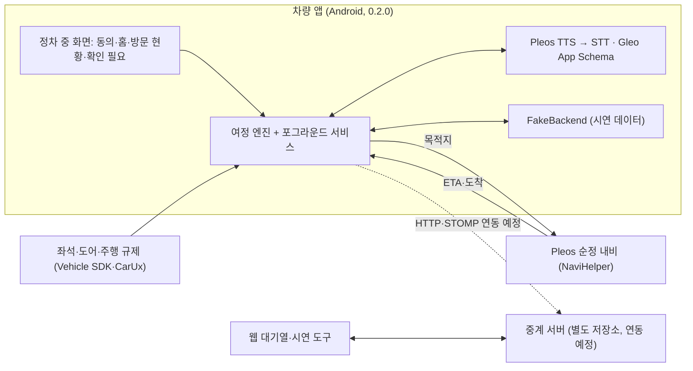

# 스마트 저니 (Smart Journey)

> 순정 내비의 도착 시각으로 웨이팅 걸 시점을 계산해, 운전 중 음성 한마디로 접수하는 Pleos Connect 차량용 방문 준비 앱

현대자동차그룹 차량용 앱 개발 공모전 1차 제출 저장소입니다. 작품 소개, 심사용 APK, 소스 코드 위치, 화면과 검증 기록을 모았습니다.

| 바로 가기 | |
| --- | --- |
| APK | [`apk/`](apk/) — 시연용 `smart-journey-0.2.0-demo-debug.apk`, 배포 빌드 `smart-journey-0.2.0-release.apk` |
| 소스 코드 (제출 시점 고정) | [smart-journey-android @ `v0.2.0-submission1`](https://github.com/smartjourney-pleos/smart-journey-android/tree/v0.2.0-submission1) |
| 화면 | [아래 화면 구성](#화면-구성) · [`docs/screenshots/`](docs/screenshots/) |
| 검증 기록 | [`docs/verification-2026-11-12.md`](docs/verification-2026-11-12.md) |

> **시연용 데이터 · 실제 매장 미접수.** 접수·대기열은 앱 안의 시연 데이터(`FakeBackend`)이며 실제 매장에 접수되지 않습니다. 앱 화면에도 이 표시가 항상 보입니다.

---

## 1. 한 줄 소개

순정 내비의 도착 시각(ETA)과 매장 예상 대기를 비교해 웨이팅을 걸 시점을 계산하고, 운전 중에는 내비를 그대로 둔 채 음성으로만 묻고 답합니다. "너무 일찍 걸어 자동 취소, 늦게 걸어 오래 대기"를 줄이는 것이 목표입니다.

## 2. 기획 배경

- **타이밍:** 웨이팅 앱은 남은 대기만, 지도 앱은 이동 시간만 압니다. 원격 웨이팅은 순서가 가까워진 뒤 정해진 시간 안에 도착 인증이 없으면 자동 취소됩니다. "대기시간 여유가 있어서 천천히 갔으나 자동취소되고 다시 예약함"(웨이팅 앱 리뷰, 2026-04).
- **대기 허용:** 아이와 함께인 가족은 대기 30분을 넘으면 다른 곳을 찾는 경우가 많습니다. 접수 시점뿐 아니라 갈지 말지 판단할 숫자가 필요합니다.
- **인원:** 일행 합류·이탈로 방문 인원이 바뀌고, "일행 모두 동시 입장" 매장이 많습니다.
- **운전 중 대응:** 운전 중 휴대폰 사용은 범칙금(승용 6만 원)·벌점 15점 대상입니다. 내비를 가리지 않고 결정해야 합니다.

## 3. 주요 기능과 차량 특화 요소

| 기능 | 동작 | 차량에서 달라지는 점 |
| --- | --- | --- |
| 방문 계획 | 정차 중 홈에서 방문지·지원 방식·인원·대기 허용 시간 확인 | 좌석 점유로 탑승 인원을 **제안**하고 사용자가 확정 |
| 도착 시각에 맞춘 음성 제안 | `남은 ETA ≤ 예상 대기 − 도착 여유(10분)`일 때 "42dot까지 20분, 대기는 30분이에요. 4명으로 지금 웨이팅을 걸까요?" | 안내 중인 경로의 ETA(NaviHelper)를 구독해 시점을 다시 계산 |
| 음성 승인 | "응", "나중에"처럼 짧은 답. 무응답·모호한 답·만료·중복은 실행하지 않음 | 주행 중 팝업·헤드업·승인 화면 없이 내비 유지 |
| 대기 허용 초과 | 예상 대기가 허용 시간(기본 30분)보다 길면 "대기가 90분이에요. 그래도 걸까요?" 보류하면 접수하지 않고 다시 묻지 않음 | 대체 매장 자동 추천·경로 변경 없음 |
| 방문 현황 | 요청 전·요청 중·확정·실패·확인 필요, 접수 번호(응답 후에만) | 응답 유실은 "확인 필요"로 두고 재접수하지 않음 |
| 도착 후 확인 | 내비 도착 + 정차 + 문 열림·닫힘 + 좌석 감소 안정으로 하차 **추정** | 일부만 내리면 "일행 3명 도착 추정 · 1명 이동 중", 도착 완료로 보지 않음 |
| 예외·미지원 | 음성 실패, 접수 확인 필요, 센서·서비스 미지원, 미연동 매장 안내 | 정차 후 확인하도록 남김 |

## 4. 주요 사용 시나리오 (시연)

1. **출발 전:** 정차 중 홈에서 방문지 42dot(데모 웨이팅), 방문 인원 4명, 대기 허용 30분을 확인하고 **방문 시작** → 순정 내비로 안내가 넘어갑니다.
2. **주행 중:** 제안 시점이 되면 앱이 질문을 읽고(Pleos TTS) 끝난 뒤 마이크를 엽니다(Pleos STT). "응" → 데모 접수 1건. 내비 화면은 그대로입니다.
3. **대기 허용 초과:** 대기가 90분으로 늘면 "그래도 걸까요?"를 묻고, "나중에"라고 하면 접수하지 않습니다.
4. **도착 후:** 운전자가 가족 3명을 먼저 내려 주면 "일행 3명 도착 추정 · 1명 이동 중", 주차 후 운전자가 내리면 4/4 하차 추정.
5. **정차 후:** 방문 현황에서 접수 번호·인원·상태를 확인합니다.

## 5. 개발 현황 (2026-11-12, 앱 0.2.0)

| 구분 | 내용 |
| --- | --- |
| **실제 SDK로 동작 (에뮬레이터 확인)** | 내비 경로 입력(`requestRouteWithWaypoints`)과 내비 화면 전환, 남은 시간 조회(`requestTrip`, 30초 주기), 좌석·도어 지원 여부 확인(Vehicle SDK), 주행 규제 상태(`CarUxRestrictions`), Pleos TTS 질문 → STT 응답(ON_DEVICE), Gleo App Schema 2개(`GET_SMART_JOURNEY_STATUS`, `RESPOND_SMART_JOURNEY_PROMPT`) |
| **데모 입력으로 동작** | 주행 중 남은 시간 감소와 도착 이벤트, 문 열림·좌석 변화(하차), 매장 대기·호출·착석(`FakeBackend`). 에뮬레이터에서 차량을 움직이거나 좌석 값을 바꿀 수 없어 디버그 빌드의 데모 패널로 넣습니다. 화면마다 **실제 SDK / 데모 입력** 배지를 표시합니다. |
| **구현했지만 에뮬레이터에서 미확인** | 안내 중 내비가 보내는 실시간 `onTripInfo` 구독. 에뮬레이터 차량이 목적지 앞에 고정돼 있고 주행 시뮬레이션을 쓸 수 없어 콜백 수신을 확인하지 못했습니다. |
| **미구현·검증 과제** | 실제 운전자 마이크·차내 소음 인식, Gleo 자연어 호출부터 결과 응답까지의 전체 흐름, 실제 서버 접수와 공식 매장·POS 연동, 차량 전화 연결, 실차 좌석·도어 변화 |

- 음성 인식 확인은 사람 발화가 아니라 **합성 한국어 음성**을 실제 Pleos ASR에 넣은 결과입니다. "응" → 승인, "나중에" → 보류로 인식됐고, "걸어 줘"는 "그렇죠" 등으로 인식돼 실행되지 않았습니다(모호한 답 미실행).
- 빌드: debug·release 빌드, 단위 테스트 49개 통과, lint 오류 0건.

## APK 설치와 시연

| 파일 | 용도 |
| --- | --- |
| `smart-journey-0.2.0-demo-debug.apk` | **시연용.** 데모 패널(상단 "데모" 버튼)과 adb 신호 주입이 들어 있어 에뮬레이터에서 전체 흐름을 볼 수 있습니다. 디버그 인증서로 서명됩니다. |
| `smart-journey-0.2.0-release.apk` | 배포 빌드(릴리스 키 서명, versionCode 2). 데모 도구가 없고 실제 차량 신호만 씁니다. 에뮬레이터에서는 차량이 움직이지 않아 주행 이후 흐름이 진행되지 않습니다. |

무결성은 [`apk/SHA256SUMS.txt`](apk/SHA256SUMS.txt)로 확인합니다. 두 APK는 같은 패키지명이라 바꿔 설치할 때 먼저 지웁니다.

```bash
adb install -r -g apk/smart-journey-0.2.0-demo-debug.apk
adb shell am start --user 10 -n com.smartjourney.vehicle/.MainActivity
```

Pleos Connect Emulator v2.1.0(API 34), Vehicle 서비스 2.3.13·Navi 서비스 2.0.1 이상이 필요합니다. 시연 순서: 동의 → 홈에서 방문지 선택 → **방문 시작** → 데모 패널에서 남은 시간 −5분 / "대기 90분 만들기" / "도착 이벤트" / "일행 3명 하차" · "운전자 하차". 터미널 명령은 [Android README](https://github.com/smartjourney-pleos/smart-journey-android/tree/v0.2.0-submission1#시연-방법)를 참고하세요.

## 화면 구성

| 1. 동의 | 2. 홈(방문 계획) |
| --- | --- |
|  |  |
| **3. 주행 음성 흐름 — 질문 중에도 내비 유지** | **4. 방문 현황** |
|  |  |
| **5. 도착 후 확인 — 일부 하차** | **6. 확인 필요(예외·미지원)** |
|  |  |

주행 중 앱을 열면 편집 없이 상태만 보입니다([03b](docs/screenshots/03b-driving-status.png)). 좁은 창·야간 테마 예: [07](docs/screenshots/07-status-narrow-night.png). 에뮬레이터 내장 지도의 배경 타일이 비어 보이는 것은 에뮬레이터 지도 데이터 문제이며 앱 화면과 무관합니다.

## 구성



## 저장소

| 저장소 | 역할 | 기술 |
| --- | --- | --- |
| [smart-journey-main](https://github.com/smartjourney-pleos/smart-journey-main) | 작품 소개, 심사용 APK, 화면·검증 기록 | Markdown |
| [smart-journey-android](https://github.com/smartjourney-pleos/smart-journey-android) | Pleos Connect 차량 앱. 1차 제출 소스는 태그 `v0.2.0-submission1` | Kotlin 2.0, Jetpack Compose, Coroutines/Flow, Vehicle SDK 2.3.2, NaviHelper 3.0.5, Pleos Speech SDK 3.3.1 |
| [smart-journey-server](https://github.com/smartjourney-pleos/smart-journey-server) | 웨이팅·대기열·도착 API와 상태 이벤트 | Java 21, Spring Boot 3.5, REST, WebSocket/STOMP |
| [smart-journey-web](https://github.com/smartjourney-pleos/smart-journey-web) | 대기열·호출·착석·데모 조작 웹 도구 | React 19, TypeScript, Vite |

## 개인정보와 안전 원칙

- 기본 전송 정보는 매장 식별자, 도착 예상 시간, 방문 인원, 접수 상태입니다. 좌표·이동 경로·차대번호는 보내지 않습니다.
- 좌석·도어 값은 인원 제안과 하차 추정에만 쓰며 신원 확인·매장 입장·노쇼 판정에 쓰지 않습니다.
- 접수·인원 변경은 사용자 승인 뒤에만 실행합니다. 방문을 끝내도 기존 접수를 자동 취소하지 않습니다.
- 로그에 음성 원본이나 개인 식별값을 남기지 않습니다(디버그 빌드의 합성 음성 검증 로그 제외).

## 참고 자료

- 공모전 개요: https://appdevchallenge.auto-hmg.io/guide/overview
- 공모전 심사 기준: https://appdevchallenge.auto-hmg.io/guide/judging-awards
- Pleos NaviHelper·Vehicle·Speech SDK: https://document.pleos.ai
- 테이블링 현장대기·원격줄서기 도움말, 캐치테이블 자동 미루기 가이드, 운전 중 휴대전화 범칙금(찾기쉬운 생활법령)
