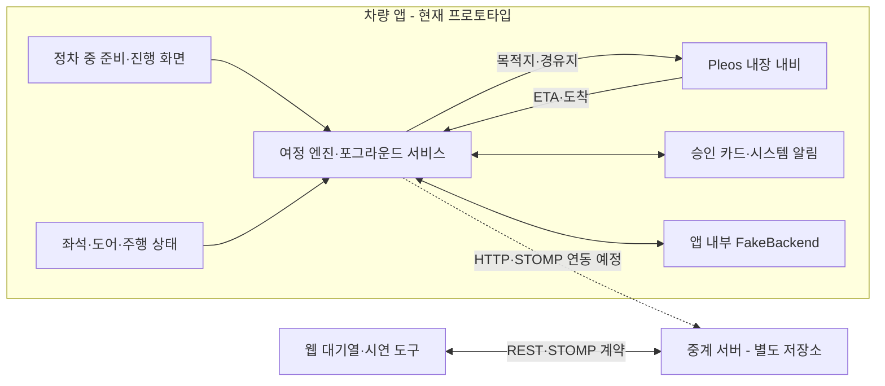

# 스마트 저니 (Smart Journey)

> 차량의 도착 시간에 맞춰 방문을 준비하는 Pleos Connect 차량용 앱

출발 전에는 탑승 인원과 방문지를 확인하고, 이동 중에는 내비게이션의 도착 예상 시간과 매장 대기시간을 비교해 웨이팅 시점을 제안합니다. 도착 후에는 안전하게 정차한 뒤 접수 번호와 도착·하차 상태를 확인합니다.

길 안내는 **Pleos 내장 내비게이션**을 사용합니다. 좌석·도어 신호는 인원 제안과 하차 추정에 활용하며, 사용자의 신원이나 매장 입장을 인증하는 수단으로 사용하지 않습니다.

## 현재 개발 상태

**2026-11-12 기준, 차량 앱은 웨이팅 흐름을 시연하는 프로토타입입니다.** Android 앱은 현재 앱 내부 `FakeBackend`로 접수·호출·착석을 처리합니다. 중계 서버와 웹 도구는 별도 저장소에 있으며, 차량 앱과의 실제 서버 연동 및 공식 매장 접수는 남아 있습니다.

| 구분 | 현재 가능한 것 | 확인 범위·남은 작업 |
| --- | --- | --- |
| 정차 중 준비 | 데이터 전송 동의, 인원 수정, 방문지·방문 순서 선택, 여정 시작 | 방문지는 최대 3곳을 처리하는 구조. 제공 목록은 빌드별 데모 데이터 사용 |
| 내비 연결 | 목적지·경유지 전달, 내장 내비 화면 전환, 남은 시간·도착 이벤트 연계 | NaviHelper SDK 연동. 실제·데모 신호를 구분해 검증 |
| 인원 제안 | 좌석 점유가 5초 유지되면 인원 제안, 직접 수정 | 짐 등을 사람과 완벽히 구분하지 못하므로 사용자 확인 필요 |
| 웨이팅 제안 | 도착 예상 시간과 대기시간을 비교해 승인 요청 | 현재는 터치 승인. Gleo 음성 승인은 통합되지 않음 |
| 접수·호출·착석 | 승인 후 데모 접수, 번호 발급, 호출 안내, 다음 매장 진행 | 앱 내부 `FakeBackend` 시연. 실제 매장에는 접수되지 않음 |
| 도착·하차 | 도착·정차·문·좌석 변화를 조합한 하차 추정, 수동 도착 확인 | 시연 신호로 흐름 확인. 실제 차량 변화·정확도 검증 필요 |
| 주행 중 제한 | 인원·방문지 편집 제한, 상태 요약·승인 알림 | 지역·차종·앱 카테고리별 플랫폼 정책 확인 필요 |

Android 저장소의 `main`과 `dev`, 로컬 작업본은 구현 범위가 다릅니다. 아래 기능 설명은 개발 중인 프로토타입 기준이며, 각 브랜치에 모두 배포된 기능을 뜻하지 않습니다.

## 사용 흐름

1. **출발 전, 정차 중**: 데이터 전송에 동의하고 인원과 방문지를 확인합니다. 선택한 순서대로 코스를 만들고 **여정 시작**을 누릅니다.
2. **내비게이션으로 이동**: 앱이 목적지·경유지를 내비에 전달하고 뒤로 물러납니다. 포그라운드 서비스가 여정 상태를 유지합니다.
3. **웨이팅 시점 제안**: 남은 도착 시간이 예상 대기시간과 도착 여유에 맞으면 “지금 웨이팅 걸까요?”라고 묻습니다. **등록**을 눌러야 접수합니다.
4. **정차 후 현황 확인**: 매장명·접수 상태·번호·앞 대기팀·도착 예상 시간을 확인합니다. 도착 후에는 하차 추정 또는 **도착했어요**로 도착을 기록합니다.
5. **호출과 다음 방문**: 데모 점주 호출·착석 처리 후 다음 매장으로 진행합니다. 재탑승 인원이 달라지면 변경을 제안합니다.

현재 코드에서 **주행 중 승인 요청은 헤드업 알림**으로 표시되며, 배너를 누르면 승인 카드가 열립니다. 정차 중에는 카드를 먼저 열고, 시스템이 막으면 알림으로 대체합니다. 음성 전용 흐름은 별도 검증·통합 과제입니다.

## 차량과 연결되는 부분

| 입력·연동 | 용도 |
| --- | --- |
| Vehicle SDK의 좌석·도어 신호 | 탑승 인원 제안, 하차 추정 보조 |
| NaviHelper의 목적지·경유지·ETA·도착 이벤트 | 내비 연결, 웨이팅 제안 시점 계산, 도착 처리 |
| `CarUxRestrictions` | 주행 중 입력·상세 조작 제한 |
| `JourneyService` | 앱이 내비 뒤에 있을 때 여정 감시와 알림 유지 |

기본 제안 조건은 `남은 도착 시간 ≤ 예상 대기시간 - 도착 여유`입니다. 대기가 도착 여유보다 짧거나 같으면 현재 구현은 바로 제안합니다. 대기정보가 바뀌면 시점을 다시 계산하며, 승인 없이 웨이팅을 접수하거나 인원을 변경하지 않습니다.

## 구성



실제 차량 신호 모드로 바꾸어도 웨이팅 백엔드는 현재 `FakeBackend`입니다. 차량 신호 연동과 매장 접수 연동을 별개로 구분합니다.

## 저장소

| 저장소 | 역할 | 기술 |
| --- | --- | --- |
| [smart-journey-main](https://github.com/smartjourney-pleos/smart-journey-main) | 프로젝트 소개와 산출물 안내 | Markdown |
| [smart-journey-android](https://github.com/smartjourney-pleos/smart-journey-android) | Pleos Connect 차량 앱. 현재 프로토타입은 [dev README](https://github.com/smartjourney-pleos/smart-journey-android/blob/dev/README.md) 참고 | Kotlin 2.0, Jetpack Compose, Coroutines/Flow, Vehicle SDK 2.3.2, NaviHelper SDK 3.0.5 |
| [smart-journey-server](https://github.com/smartjourney-pleos/smart-journey-server) | 웨이팅·대기열·도착·POS API와 상태 이벤트 | Java 21, Spring Boot 3.5, REST, WebSocket/STOMP, JPA, Flyway, PostgreSQL/H2 |
| [smart-journey-web](https://github.com/smartjourney-pleos/smart-journey-web) | 대기열·호출·착석·노쇼·데모 조작을 위한 웹 도구 | React 19, TypeScript, Vite, Tailwind CSS 4 |

웹 도구와 자체 서버의 시연은 외부 예약 플랫폼이나 실제 매장과의 제휴 완료를 의미하지 않습니다. 실제 운영 매장 연동은 공식 권한·제공자 계약을 확인한 뒤 진행합니다.

## 실행 방법

### 차량 앱 프로토타입

Android Studio, JDK 17 이상(JDK 21 사용), Android SDK와 Pleos Connect Emulator가 필요합니다. Vehicle 서비스 2.3.13 이상, Navi 서비스 2.0.1 이상을 기준으로 확인합니다.

```bash
git clone --branch dev https://github.com/smartjourney-pleos/smart-journey-android.git
cd smart-journey-android
./gradlew :app:assembleDebug
./gradlew :app:testDebugUnitTest
```

Android SDK 경로는 Android Studio 또는 `local.properties`에서 설정합니다. 디버그 APK를 에뮬레이터에 설치한 뒤 **동의 → 인원 확인 → 방문지 선택 → 여정 시작** 순서로 진행합니다. 현재 앱의 데모 웨이팅은 서버를 별도로 실행하지 않아도 동작합니다.

차량·내비 신호의 시연 조작은 debug 빌드의 **데모 패널** 또는 저장소의 `scripts/demo.sh`를 사용합니다. `real`/`fake` 제품 변형을 고르는 방식이 아니라 신호 모드를 전환하는 구조입니다. 여러 adb 기기가 연결된 경우 대상 기기를 지정해 조작합니다.

### 서버와 웹 도구

서버 저장소에서:

```bash
./gradlew bootRun
```

로컬 기본 구성은 H2이며, API 문서는 `http://localhost:8080/swagger-ui.html`입니다. PostgreSQL 설정은 [서버 README](https://github.com/smartjourney-pleos/smart-journey-server#readme)를 참고합니다.

웹 저장소에서:

```bash
npm install
npm run dev
```

웹 개발 서버는 `/api`, `/ws`를 로컬 서버의 8080 포트로 전달하며, 서버가 없으면 목 데이터로 동작합니다. Pleos 에뮬레이터에서 개발 PC의 서버에 접근할 때는 `http://10.0.2.2:8080`을 사용합니다. 이 서버 실행만으로 차량 앱의 `FakeBackend`가 실서버 구현으로 바뀌지는 않습니다.

## 개발 규칙

Pleos 관련 작업은 [공통 개발 규칙](docs/development/pleos-connect-rules.md)을 기준으로 진행합니다. 사용자가 제공한 `pleos-connect-archive.html`에서 주행 규제·UI·SDK·내비·음성·보안·테스트·배포 기준을 정리하고, 원문의 필수·권장 사항과 프로젝트 자체 기준을 구분했습니다.

Codex 등 자동 작업 도구는 [AGENTS.md](AGENTS.md), Claude는 [CLAUDE.md](CLAUDE.md)를 진입점으로 읽습니다. 원본 스냅샷의 날짜·SHA-256·article ID와 공식 원문 링크를 규칙 문서에 기록했습니다.

## 최근 화면 보완과 검증

2026-11-12 Android 개발 작업본([PR #4](https://github.com/smartjourney-pleos/smart-journey-android/pull/4))에서 다음을 보완했습니다.

- 여정 시작 버튼의 로딩 표시, 중복 클릭 차단, 비활성 사유·오류 안내
- 좁은 창의 진행 지표·헤더·주행 안내 배치
- 주행 제한을 동의 화면보다 먼저 적용하는 화면 분기
- 센서 인원 제안·하차 추정, 앱 내부 시연 데이터 고지, 동의 목적·거부 영향·철회 위치 안내

debug/release 빌드, 단위 테스트 30개, 린트 오류 0건을 확인했습니다. 별도 Pleos 에뮬레이터에서 화면을 확인했으며, 크기·테마 전환 직후 일부 캡처의 일시적 미갱신도 기록했습니다. 실차·모든 화면 전환·공식 매장 연동 검증은 남아 있습니다.

이 화면 보완과 Android용 규칙 진입점은 위 PR에 커밋·푸시했으며 검토 중입니다. `dev`·`main` 병합과 APK 업로드는 아직 진행하지 않았습니다.

## 다음 작업

| 우선순위 | 작업 |
| --- | --- |
| P0 | 화면 보완 코드 통합, 주야간·분할 창·오류 상태 추가 검증 |
| P0 | 차량 앱과 중계 서버의 실제 HTTP·STOMP 연결, 재연결·접수 결과·중복 방지 검증 |
| P0 | 실제 차량 신호 변화와 지역·차종별 주행 제한 동작 확인 |
| P1 | Gleo 음성 제안·승인과 내비 화면 유지 흐름의 통합 검증 |
| P1 | 권한을 확보한 실제 매장과 접수·조회·변경·취소 연동 검증 |
| P2 | 제공자가 지원하는 범위에서 다중 방문·지연 대응 기능 확장 |

예약·전화 연결, QR 표시, 순번 미루기 등은 현재 차량 앱의 완료 기능으로 소개하지 않습니다.

## 데이터와 개인정보

- 웨이팅 흐름에 필요한 인원·하차 인원·도착 예상 시간·도착 여부·웨이팅 정보를 최소한으로 다룹니다.
- 외부 접수 데이터에는 정밀 위치 좌표·이동 경로·VIN을 포함하지 않는 설계입니다. 내비 경로 설정에 쓰는 장소 좌표와 외부 전송 항목을 구분합니다.
- 데이터 전송 동의 전에는 여정을 시작할 수 없습니다. 동의 화면에는 목적·수신처·보유 기간과 거부 영향을 안내합니다.
- 현재 고지의 보유 기간은 30일입니다. 실제 서버 연동 시 저장·파기 동작과 고지가 일치하는지 확인합니다.

## APK와 배포

[apk/](apk/)는 최종 산출물 보관 위치입니다. **현재 이 저장소에는 배포용 APK가 업로드되어 있지 않습니다.**

Android 빌드 결과는 해당 저장소의 `app/build/outputs/apk/`에 생성됩니다. 로컬 검증의 release APK는 서명되지 않은 파일이며, 제출·배포 전 정식 서명과 대상 기기 검증이 필요합니다.

## 기여 규칙

이 저장소는 프로젝트 소개·산출물 안내용으로 `main`을 사용합니다. 코드 작업과 PR 대상 브랜치는 각 저장소의 규칙을 따릅니다.

공개 저장소에 API 키, DB 비밀번호, `.env`, `local.properties`, 서명 키 또는 개인정보가 담긴 제출 양식을 올리지 않습니다.
