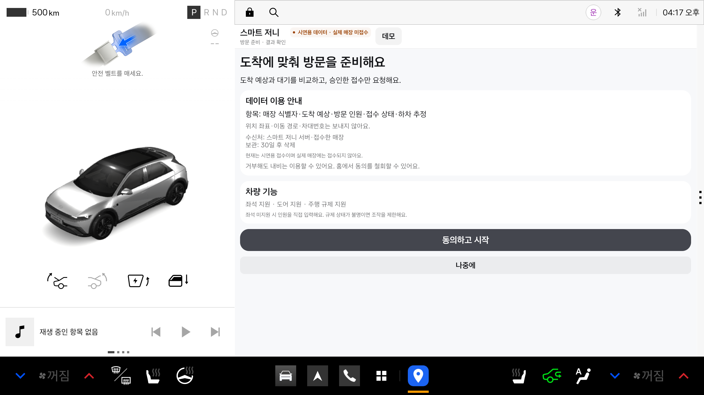
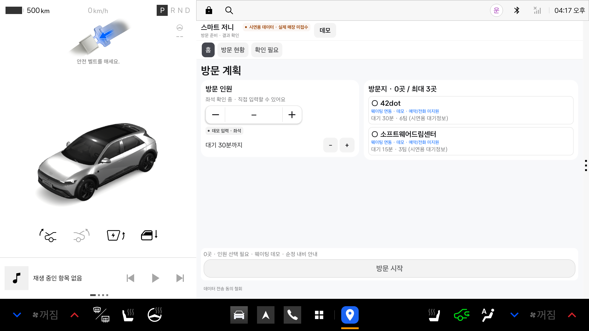
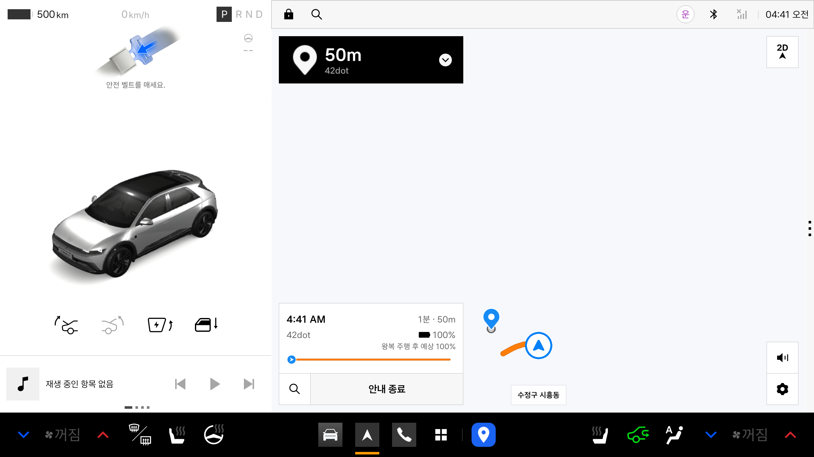
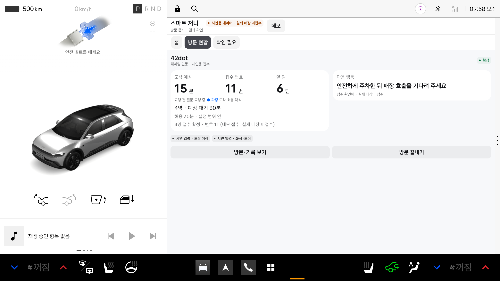
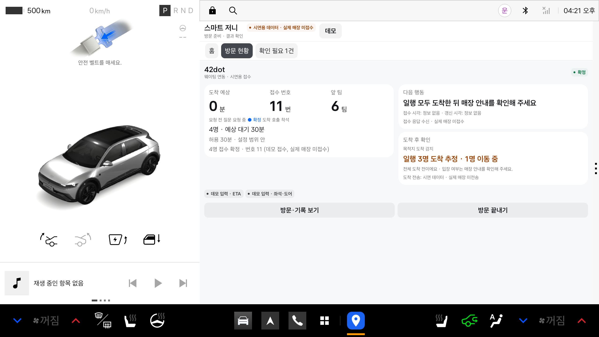
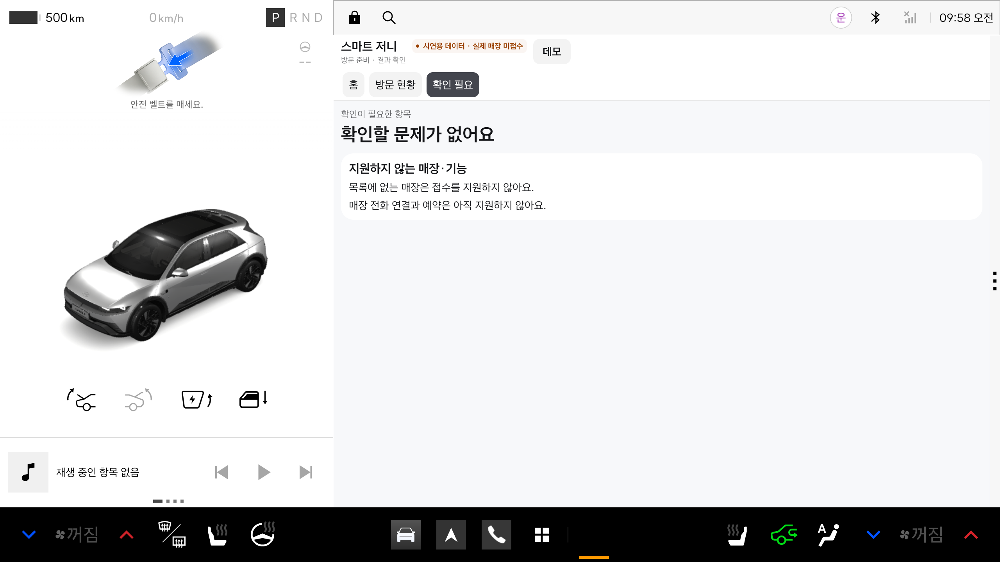

# 스마트 저니 (Smart Journey)

> 순정 내비의 도착 시각으로 웨이팅 걸 시점을 계산해, 운전 중 음성 한마디로 접수하는 Pleos Connect 차량용 방문 준비 앱

현대자동차그룹 차량용 앱 개발 공모전 1차 제출 저장소입니다. 1차 기획 검증용 프로토타입이며 최신 APK는 **0.2.10**입니다. 작품 소개, 심사용 APK, 소스 코드 위치, 화면과 검증 기록을 모았습니다.

| 바로 가기 | |
| --- | --- |
| APK | [`apk/`](apk/) — 시연용 `smart-journey-0.2.10-demo-debug.apk`, 배포 빌드 `smart-journey-0.2.10-release.apk` (0.2.8 파일은 이전 버전) |
| 실행 방법 | [아래 실행 방법](#실행-방법) — 테스트 환경, 설치, 시연 시나리오 2개 |
| 소스 코드 (0.2.10 고정) | [smart-journey-android @ `d84e740`](https://github.com/smartjourney-pleos/smart-journey-android/tree/d84e740ce14b6ba579ed0c7028e45386daeefe33) · [zip 내려받기](https://github.com/smartjourney-pleos/smart-journey-android/archive/d84e740ce14b6ba579ed0c7028e45386daeefe33.zip) |
| 화면 | [아래 화면 구성](#화면-구성) · [`docs/screenshots/`](docs/screenshots/) |
| 검증 기록 | [0.2.10](docs/verification-0.2.10.md) · 이전: [0.2.8](docs/verification-0.2.8.md), [앱 전체](docs/verification-2026-11-12.md), [Gleo AI 음성 연동](docs/verification-gleo-2026-11-12.md) |

> **시연용 데이터 · 실제 매장 미접수.** 접수·대기열은 앱 안의 시연 데이터(`FakeBackend`)이며 실제 매장에 접수되지 않습니다. 앱 화면에도 이 표시가 항상 보입니다.

---

## 1. 한 줄 소개

순정 내비의 도착 시각(ETA)과 매장 예상 대기를 비교해 웨이팅을 걸 시점을 계산하고, 운전 중에는 내비를 그대로 둔 채 음성으로만 묻고 답합니다. "너무 일찍 걸어 자동 취소, 늦게 걸어 오래 대기"를 줄이는 것이 목표입니다.

## 2. 기획 배경

- **타이밍:** 웨이팅 앱은 남은 대기만, 지도 앱은 이동 시간만 압니다. 원격 웨이팅은 순서가 가까워진 뒤 정해진 시간 안에 도착 인증이 없으면 자동 취소됩니다. "대기시간 여유가 있어서 천천히 갔으나 자동취소되고 다시 예약함"(웨이팅 앱 리뷰, 2026-04).
- **대기 허용:** 아이와 함께인 가족은 대기 30분을 넘으면 다른 곳을 찾는 경우가 많습니다. 접수 시점뿐 아니라 갈지 말지 판단할 숫자가 필요합니다.
- **인원:** 일행 합류·이탈로 방문 인원이 바뀌고, "일행 모두 동시 입장" 매장이 많습니다.
- **운전 중 대응:** 운전 중 휴대폰 사용은 범칙금(승용 6만 원)·벌점 15점 대상입니다. 내비를 가리지 않고 결정해야 합니다.

## 3. 주요 기능과 차량 특화 요소

| 기능 | 동작 | 차량에서 달라지는 점 |
| --- | --- | --- |
| 방문 계획 | 정차 중 홈에서 방문지·지원 방식·인원·대기 허용 시간 확인 | 좌석 점유로 탑승 인원을 **제안**하고 사용자가 확정 |
| 도착 시각에 맞춘 음성 제안 | `남은 ETA ≤ 예상 대기 − 도착 여유(10분)`일 때 "42dot까지 20분, 대기는 30분이에요. 4명으로 지금 웨이팅을 걸까요?" | 안내 중인 경로의 ETA(NaviHelper)를 구독해 시점을 다시 계산 |
| 음성 승인 | "응", "나중에"처럼 짧은 답. 무응답·모호한 답·만료·중복은 실행하지 않음 | 주행 중 팝업·헤드업·승인 화면 없이 내비 유지 |
| 대기 허용 초과 | 예상 대기가 허용 시간(기본 30분)보다 길면 "대기가 90분이에요. 그래도 걸까요?" 보류하면 접수하지 않고 다시 묻지 않음 | 대체 매장 자동 추천·경로 변경 없음 |
| 방문 현황 | 요청 전·요청 중·확정·실패·확인 필요, 접수 번호(응답 후에만) | 응답 유실은 "확인 필요"로 두고 재접수하지 않음 |
| 도착 후 확인 | 내비 도착 + 정차 + 문 열림·닫힘 + 좌석 감소 안정으로 하차 **추정** | 일부만 내리면 "일행 3명 도착 추정 · 1명 이동 중", 도착 완료로 보지 않음 |
| 내비 안내 종료 | 순정 내비에서 안내를 끝내면(SDK가 종료 뒤에 알려 줌) **접수 전** 방문은 닫고, 이미 접수한 방문은 그대로 두고 알림. 앱의 "방문 끝내기"는 접수했거나 결과를 모르면 확인을 받음 | 접수는 자동 취소하지 않음. 목적지 변경은 방문을 닫지 않음 |
| 예외·미지원 | 음성 실패, 접수 확인 필요, 센서·서비스 미지원, 미연동 매장 안내 | 정차 후 확인하도록 남김 |

## 4. 주요 사용 시나리오 (시연)

1. **출발 전:** 정차 중 홈에서 방문지 42dot(데모 웨이팅), 방문 인원 4명, 대기 허용 30분을 확인하고 **방문 시작** → 순정 내비로 안내가 넘어갑니다.
2. **주행 중:** 제안 시점이 되면 앱이 질문을 읽고(Pleos TTS) 끝난 뒤 마이크를 엽니다(Pleos STT). "응" → 데모 접수 1건. 내비 화면은 그대로입니다.
3. **대기 허용 초과:** 대기가 90분으로 늘면 "그래도 걸까요?"를 묻고, "나중에"라고 하면 접수하지 않습니다.
4. **도착 후:** 운전자가 가족 3명을 먼저 내려 주면 "일행 3명 도착 추정 · 1명 이동 중", 주차 후 운전자가 내리면 4/4 하차 추정.
5. **정차 후:** 방문 현황에서 접수 번호·인원·상태를 확인합니다.

## 5. 개발 현황 (2026-11-13, 앱 0.2.10)

| 구분 | 내용 |
| --- | --- |
| **실제 SDK로 동작 (에뮬레이터 확인)** | 내비 경로 입력(`requestRouteWithWaypoints`)과 내비 화면 전환, 남은 시간 조회(`requestTrip`, 30초 주기), 좌석·도어 지원 여부 확인(Vehicle SDK), 주행 규제 상태(`CarUxRestrictions`), Pleos TTS 질문 → STT 응답(ON_DEVICE), 순정 내비 "안내 종료" 시 접수 전 방문 정리(서명된 0.2.9로 강제 권한 없는 설치에서 별도 검증자 확인) |
| **Gleo AI** | 0.2.10은 **상태 조회만** 연결합니다(스키마 함수 1개, 에뮬레이터 등록 확인). Gleo가 앱에 주는 값은 모델이 만든 파라미터뿐이라 사용자가 새로 답했는지 확인할 수 없어 **Gleo를 통한 접수·인원 변경 승인은 막았습니다.** 상태 조회 자연어 왕복은 이전 빌드(0.2.5)에서 Mac `say` 합성 음성을 호스트 마이크로 넣어 시험한 결과이며 0.2.10에서는 재시험하지 않았습니다. |
| **데모 입력으로 동작** | 주행 중 남은 시간 감소와 도착 이벤트, 문 열림·좌석 변화(하차), 매장 대기·호출·착석(`FakeBackend`). 에뮬레이터에서 차량을 움직이거나 좌석 값을 바꿀 수 없어 디버그 빌드의 데모 패널로 넣습니다. 화면마다 **실제 / 시연 입력** 배지를 표시합니다. |
| **구현했지만 에뮬레이터에서 미확인** | 안내 중 내비가 보내는 실시간 `onTripInfo` 구독. 에뮬레이터 차량이 목적지 앞에 고정돼 있어 콜백 수신을 확인하지 못했습니다. |
| **연동 준비** | 웹 POS와 공유하는 [smart-journey-server](https://github.com/smartjourney-pleos/smart-journey-server) REST 연동 코드(디버그 빌드 스위치). 서버 접수·POS API 구현 전이라 1차 시연은 앱 안 시연 데이터로 진행합니다. |
| **지도 위 질문 카드** | "다른 앱 위 표시" 권한이 있을 때만 뜹니다(10초 링, 주행 규제 중 터치 차단). 현재 Pleos 에뮬레이터 이미지에서는 사용자가 이 권한을 허용하는 설정 화면을 찾지 못해 일반 설치에서는 표시되지 않고 음성 질문이 기본입니다. 카드 동작은 권한을 따로 부여한 QA 환경에서만 확인했습니다. 이 에뮬레이터에서 관찰한 제약이며 공식 금지로 확인한 것은 아닙니다. |
| **미구현·검증 과제** | Gleo로 승인하는 흐름(새 사용자 발화 증거 확보 전까지 차단), 사람이 말하는 마이크 입력과 Gleo 대화 전체, 순정 내비 "안내 종료" 전 확인(공개 SDK에 종료 전 이벤트 없음), 차내 소음 인식, 실제 서버 접수와 공식 매장·POS 연동, 차량 전화 연결, 실차 좌석·도어 변화 |

- 0.2.10 빌드: debug·release 빌드, 단위 테스트 87개 통과, lint 오류 0건. 별도 검증자가 서명 release APK와 Gleo 관련 테스트를 독립 확인했습니다([기록](docs/verification-0.2.10.md)).
- 음성 인식 결과(합성 한국어 음성 "응" → 승인, "나중에" → 보류, "걸어 줘" → "그렇죠"로 인식돼 미실행)는 이전 빌드에서 확인한 것입니다. 0.2.10에서는 단위 테스트와 STT 요청 진입만 확인했습니다.

## 실행 방법

### 테스트 환경·필요한 설정

| 항목 | 내용 |
| --- | --- |
| 에뮬레이터 | Pleos Connect Emulator v2.1.0 (Android Automotive, API 34). 앱은 운전자 사용자(`--user 10`)로 실행됩니다. |
| 필요한 서비스 | Vehicle 서비스 2.3.13 이상, Navi 서비스 2.0.1 이상 (에뮬레이터 기본 설치) |
| 네트워크·계정 | 필요 없음. 접수·대기열은 앱 안 시연 데이터입니다. 서버·API 키·로그인 없이 동작합니다. |
| 권한 | 설치할 때 `-g`로 허용됩니다(알림·차량 좌석/도어·내비·음성). |
| 마이크 | 선택. 음성으로 답하려면 에뮬레이터를 `-allow-host-audio` 옵션으로 실행합니다(없으면 마이크가 무음). 마이크 없이도 아래처럼 정차 후 화면에서 답할 수 있습니다. |

### APK

| 파일 | 용도 |
| --- | --- |
| [`apk/smart-journey-0.2.10-demo-debug.apk`](apk/smart-journey-0.2.10-demo-debug.apk) | **시연용 (심사 시 이 파일 권장).** 데모 패널(상단 "데모" 버튼)이 있어 에뮬레이터에서 주행·도착·하차를 넣어 전체 흐름을 볼 수 있습니다. 소스 커밋 `d84e740`의 디버그 빌드입니다. |
| [`apk/smart-journey-0.2.10-release.apk`](apk/smart-journey-0.2.10-release.apk) | 배포 빌드(릴리스 키 서명, versionCode 12). 데모 도구가 없어 에뮬레이터에서는 주행 이후 흐름이 진행되지 않습니다. |
| `apk/smart-journey-0.2.8-*.apk` | **이전 버전(최신 아님).** Gleo 승인 차단 전 빌드로, 비교용으로만 남겨 두었습니다. |

무결성은 [`apk/SHA256SUMS.txt`](apk/SHA256SUMS.txt)로 확인합니다. 두 APK는 같은 패키지라 바꿔 설치할 때는 먼저 `adb uninstall com.smartjourney.vehicle`을 실행합니다.

### 1. 설치·실행

```bash
git clone https://github.com/smartjourney-pleos/smart-journey-main.git && cd smart-journey-main
adb install -r -g apk/smart-journey-0.2.10-demo-debug.apk
adb shell am start --user 10 -n com.smartjourney.vehicle/.MainActivity
```

에뮬레이터 앱 목록의 **스마트 저니** 아이콘으로도 열 수 있습니다.

### 2. 시나리오 A — 도착 시각에 맞춘 접수와 일부 하차 (약 3분)

1. **동의하고 시작**을 누릅니다.
2. 홈에서 방문지 **42dot**(대기 30분)을 누르고 방문 인원 4명을 확인한 뒤 **방문 시작**을 누릅니다. 순정 내비가 앞으로 나오고 2초 뒤 시연용 주행이 시작됩니다.
3. 약 5초 뒤 앱이 "42dot까지 20분, 대기는 30분이에요. 4명으로 지금 웨이팅을 걸까요?"라고 읽습니다. 마이크가 있으면 **"응"**이라고 답합니다.
4. 마이크가 없으면 스마트 저니를 다시 열고 상단 **데모** → 패널의 **정차** → **방문 현황** 탭에서 **걸기**를 누릅니다. 질문이 만료됐으면 **접수 여부 확인** → **걸기**를 누릅니다.
5. 방문 현황에 "4명 접수 확정 · 번호 11 (데모 접수)"가 나옵니다.
6. 데모 패널의 **일행 3명 하차**를 누르면 약 10초 뒤 "일행 3명 도착 추정 · 1명 이동 중"이 나오고 도착 완료로 보지 않습니다.
7. **운전자 하차**를 누르면 "차량 신호 기준 4/4명 하차 추정"으로 바뀝니다.

### 3. 시나리오 B — 대기 허용 시간 초과 (약 2분)

1. 방문 현황의 **방문 끝내기** → **홈**으로 갑니다.
2. **대기 30분까지** 옆의 **−**를 두 번 눌러 대기 허용 시간을 10분으로 줄입니다.
3. 방문지 **소프트웨어드림센터**(대기 15분)를 고릅니다. 방문 인원이 비어 있으면 **+**로 정합니다. **방문 시작**을 누릅니다.
4. 스마트 저니로 돌아와 데모 패널 **정차** → **방문 현황** → **접수 여부 확인**을 누르면 "소프트웨어드림센터 대기가 15분이에요. 그래도 걸까요?"가 나옵니다.
5. **보류**를 누르면 접수하지 않고 다시 묻지 않습니다. 다른 매장을 자동으로 추천하거나 경로를 바꾸지 않습니다.

### 4. 시나리오 C — Gleo AI로 상태 묻기 (선택, 마이크 필요)

1. 시나리오 A의 2~3단계처럼 방문을 시작해 질문이 나오게 합니다.
2. "**Gleo**"라고 불러 Gleo를 깨운 뒤 "**스마트 저니 상태 알려 줘**"라고 말합니다.
3. Gleo가 스마트 저니를 호출해 현재 방문 상태와 기다리는 질문이 있는지 안내합니다.
4. **Gleo로는 접수·인원 변경을 승인할 수 없습니다(0.2.10).** 접수 승인은 시나리오 A처럼 앱 음성 질문이나 정차 후 화면에서 합니다. 이 시나리오는 0.2.10에서 사람 목소리로 재시험하지 않았습니다.

### 5. 시나리오 D — 내비 안내 종료 (약 1분)

1. 시나리오 A의 1~2단계처럼 방문을 시작하고 질문이 나오기 전에 순정 내비의 **안내 종료**를 누릅니다.
2. 스마트 저니를 열면 접수 전 방문이 사라지고 방문 계획 화면으로 돌아옵니다.
3. 시나리오 A로 접수를 확정한 뒤 같은 방법으로 내비 안내를 끝내면 방문과 접수는 유지되고 "이미 접수한 웨이팅은 유지돼요" 알림이 뜹니다.
4. 방문 현황의 **방문 끝내기**는 접수한 방문이면 확인창("계속 안내" / "안내 종료")을 거치며 접수는 취소하지 않습니다.

### 참고

- 데모 패널은 디버그 APK에만 있는 시연 도구입니다. 실제 차량에서는 이 값이 차량 신호와 내비에서 들어옵니다.
- 에뮬레이터 내장 지도의 배경 타일이 비어 보이는 것은 에뮬레이터 지도 데이터 문제이며 앱과 무관합니다.
- 터미널로 신호를 넣는 방법은 [Android README](https://github.com/smartjourney-pleos/smart-journey-android/tree/d84e740ce14b6ba579ed0c7028e45386daeefe33#시연-방법)에 있습니다.

## 화면 구성

| 1. 동의 | 2. 홈(방문 계획) |
| --- | --- |
|  |  |
| **3. 주행 음성 흐름 — 질문 중에도 내비 유지** | **4. 방문 현황** |
|  |  |
| **5. 도착 후 확인 — 일부 하차** | **6. 확인 필요(예외·미지원)** |
|  |  |

방문 현황은 요약·도착 예상·접수 번호·앞 팀·진행 단계·다음 행동·도착 후 확인을 한 화면에 보여 줍니다. 주행 중 앱을 열면 편집 없이 상태만 보입니다([03b](docs/screenshots/03b-driving-status.png)). 에뮬레이터 내장 지도의 배경 타일이 비어 보이는 것은 에뮬레이터 지도 데이터 문제이며 앱 화면과 무관합니다.

## 구성


## 저장소

| 저장소 | 역할 | 기술 |
| --- | --- | --- |
| [smart-journey-main](https://github.com/smartjourney-pleos/smart-journey-main) | 작품 소개, 심사용 APK, 화면·검증 기록 | Markdown |
| [smart-journey-android](https://github.com/smartjourney-pleos/smart-journey-android) | Pleos Connect 차량 앱. 0.2.10 소스는 main 커밋 `d84e740`(이전 제출 태그 `v0.2.8-submission1`은 이전 버전) | Kotlin 2.0, Jetpack Compose, Coroutines/Flow, Vehicle SDK 2.3.2, NaviHelper 3.0.5, Pleos Speech SDK 3.3.1 |
| [smart-journey-server](https://github.com/smartjourney-pleos/smart-journey-server) | 웨이팅·대기열·도착 API와 상태 이벤트 | Java 21, Spring Boot 3.5, REST, WebSocket/STOMP |
| [smart-journey-web](https://github.com/smartjourney-pleos/smart-journey-web) | 대기열·호출·착석·데모 조작 웹 도구 | React 19, TypeScript, Vite |

## 개인정보와 안전 원칙

- 기본 전송 정보는 매장 식별자, 도착 예상 시간, 방문 인원, 접수 상태입니다. 좌표·이동 경로·차대번호는 보내지 않습니다.
- 좌석·도어 값은 인원 제안과 하차 추정에만 쓰며 신원 확인·매장 입장·노쇼 판정에 쓰지 않습니다.
- 접수·인원 변경은 사용자 승인 뒤에만 실행합니다. 방문을 끝내도 기존 접수를 자동 취소하지 않습니다.
- 로그에 음성 원본이나 개인 식별값을 남기지 않습니다(디버그 빌드의 합성 음성 검증 로그 제외).

## 참고 자료

- 공모전 개요: https://appdevchallenge.auto-hmg.io/guide/overview
- 공모전 심사 기준: https://appdevchallenge.auto-hmg.io/guide/judging-awards
- Pleos NaviHelper·Vehicle·Speech SDK: https://document.pleos.ai
- 테이블링 현장대기·원격줄서기 도움말, 캐치테이블 자동 미루기 가이드, 운전 중 휴대전화 범칙금(찾기쉬운 생활법령)
