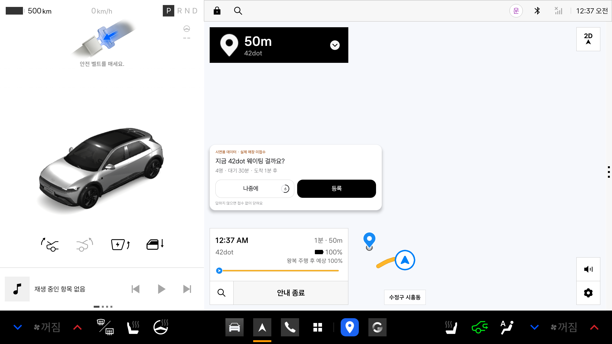
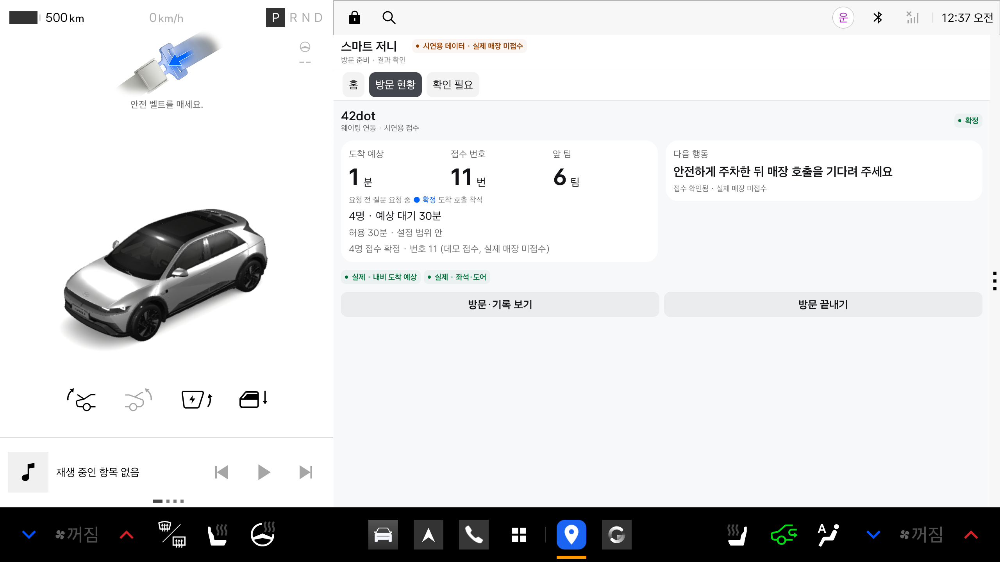
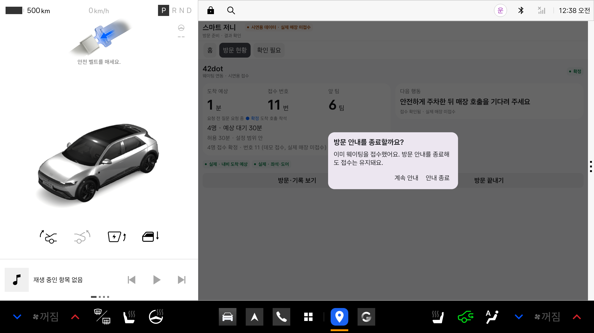

# 0.2.11 서명 release 실행 확인

2026-11-13. 제출 저장소의 `apk/smart-journey-0.2.11-release.apk`를 사용했다. 앱 코드·버전·APK를 새로 빌드하거나 변경하지 않았다.

## 설치 및 조건

- 별도 Pleos AVD `SmartJourney_Pleos`, adb `emulator-5580`, 운전자 사용자 10.
- 기존 0.2.11 debug 앱의 내부 데이터를 비공개 임시 위치에 백업하고 debug를 삭제한 뒤 release를 `adb install -g`로 설치했다. 업데이트 설치 시험이 아니다.
- 설치 정보 versionName 0.2.11, versionCode 13. `DEBUGGABLE` 플래그가 없고 DemoReceiver·ProbeActivity·SpeechProbeActivity가 패키지에 없다.
- 데모 패널·신호 주입·웹 서버·외부 접수 서버를 사용하지 않았다. 실제 SDK가 읽은 에뮬레이터의 좌석 4명·P 상태·내비 ETA를 사용했다. 실차 센서 검증은 아니다.
- 이 에뮬레이터 설치에는 표시 권한이 있어 순정 내비 위 질문 카드가 표시됐다. 일반 설치에서 권한을 부여할 수 있는지는 별도 검증이며 모든 설치에서 카드 표시를 보장하지 않는다.

## 직접 확인한 순서

1. 이용 동의 → 홈. 데모 버튼 없음.
2. 좌석 SDK의 4명 제안 확인 → 방문지 42dot 선택 → 방문 시작.
3. 순정 내비가 42dot 경로로 전환. 내비 SDK의 ETA 1분을 앱이 읽음.
4. 앱 내부 대기 30분과 비교해 접수 질문 표시. 첫 질문은 답하지 않아 접수되지 않음.
5. 정차 상태에서 앱 방문 현황 → 접수 여부 확인 → 걸기 승인.
6. `4명 접수 확정 · 번호 11 (데모 접수, 실제 매장 미접수)` 표시. 화면 출처 배지는 `실제 · 내비 도착 예상`, `실제 · 좌석·도어`.
7. 방문 끝내기를 누르면 기존 접수 유지 안내와 계속 안내/안내 종료 확인창. 계속 안내를 선택해 확정 상태를 유지함.

## 결과와 한계

release도 에뮬레이터의 실제 내비 ETA가 들어오는 현재 환경에서는 **목적지 설정·순정 내비 전환·접수 질문·터치 승인·접수 확정**까지 시연할 수 있다. ‘release라 에뮬레이터에서 이후 흐름이 전혀 진행되지 않는다’는 설명은 부정확하다.

접수 결과는 여전히 앱 내부 FakeBackend 데이터다. release의 외부 서버·웹 POS 연동을 확인한 것이 아니다. 하차·호출·착석을 강제로 발생시키는 debug 도구는 없으며 이 뒤 단계는 이번에 확인하지 않았다. 사람 음성 인식, 실차, 공식 매장 접수와 공식 폼 팩터 검증도 수행하지 않았다. 정상 실행과 접수 확정을 관찰했으며 크래시는 관찰하지 않았다. 녹화는 화면 영상이며 오디오는 포함하지 않는다.

기기는 0.2.11 release의 접수 확정 화면을 유지했다. 기존 제출용 61초 debug 편집 영상은 교체하지 않았다.
